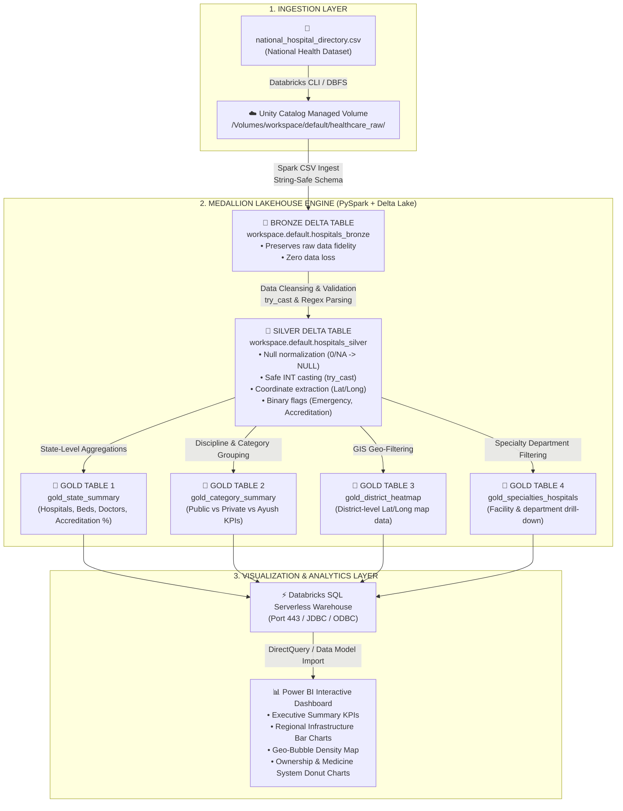

# 🏥 FINAL PROJECT REPORT
## Healthcare – Hospital Operations & Capacity Intelligence
### Big Data Engineering Industry Project | Academic Year 2026

---

## Executive Summary

This project delivers an end-to-end, enterprise-grade Big Data Engineering pipeline and business intelligence solution analyzing national hospital infrastructure, capacity allocation, emergency preparedness, and operational efficiency across India. 

Leveraging **Apache Spark (PySpark)** and **Delta Lake** on **Databricks Serverless Compute**, the solution implements the **Medallion Architecture (Bronze $\rightarrow$ Silver $\rightarrow$ Gold)** to ingest, sanitize, transform, and aggregate raw health facility data into high-performance analytical data models. The resulting Gold Layer serves an interactive **Power BI** executive dashboard, enabling healthcare administrators, emergency response networks, and policy planners to monitor hospital bed occupancy readiness, regional care imbalances, and medical specialization coverage in real time.

---

## 1. Problem Statement & Real-World Motivation

### Real-World Challenge
During healthcare emergencies and seasonal epidemics, administrative bodies face severe deficits in real-time situational awareness. Hospital data is traditionally collected through decentralized directories with inconsistent reporting standards:
1. **Capacity Silos:** Bed numbers and doctor headcounts are frequently missing, mislabeled, or corrupt (e.g., 10-digit telephone numbers mistakenly placed into bed capacity attributes).
2. **Geographical Blindspots:** Raw coordinates stored as unparsed strings prevent GIS mapping and distance-to-care routing.
3. **Emergency Care Disparities:** Lack of aggregated indicators identifying which tertiary hospitals possess 24/7 emergency trauma units and blood bank facilities.

### Project Goals
* **Automate Extraction & Storage:** Secure raw ingestion into a governed cloud object store (Databricks Unity Catalog Volume).
* **Fault-Tolerant ETL Pipeline:** Build PySpark transformation logic capable of handling data anomalies, schema enforcement, and null normalization without data loss.
* **Medallion Lakehouse Storage:** Persist ACID-compliant Delta tables at Bronze, Silver, and Gold tiers.
* **Actionable BI Dashboard:** Power interactive visual storytelling in Power BI covering executive KPIs, geographic density maps, and category breakdowns.

---

## 2. End-to-End System Architecture

---

## 3. Data Pipeline Engineering & Implementation

### 3.1 Bronze Layer (Raw Ingestion)
* **Design Philosophy:** Faithful capture of source data without schema mutation.
* **Technical Challenge:** Raw files contained embedded commas and multiline addresses.
* **Solution:** Configured Spark DataFrame reader with `multiLine=true`, `escape="\""`, and uniform string typing.
* **Target:** `workspace.default.hospitals_bronze` (Delta format with full transaction log).

### 3.2 Silver Layer (Cleansing, Validation & Feature Engineering)
* **Null Value Normalization:** Transformed placeholder values (`"0"`, `"NA"`, `"na"`, empty strings) into standard ANSI SQL `NULL` values across all attributes.
* **Safe Integer Casting (`try_cast` Innovation):**  
  Standard `.cast(IntegerType())` failed with runtime exceptions (`CAST_INVALID_INPUT`) because telephone numbers (e.g. `'9686825522'`) exceeded the maximum 32-bit signed integer value ($2,147,483,647$) in doctor/bed fields. We implemented PySpark SQL's `try_cast(col as INT)`, converting overflow records into `NULL` safely without crashing the batch job.
* **Geospatial De-serialization:** Parsed `Location_Coordinates` (`"11.6357, 92.7120"`) into distinct `DoubleType` fields: `Latitude` and `Longitude`.
* **Feature Engineering:**
  * `Has_Emergency`: Flag (1/0) indicating availability of 24/7 emergency services.
  * `Is_Accredited`: Flag (1/0) indicating formal hospital accreditation (NABH, JCI).
  * `Hospital_Category_Clean`: Cleaned ownership hierarchy (Public/Government, Private, Ayush, Unknown).
* **Target:** `workspace.default.hospitals_silver`.

### 3.3 Gold Layer (Analytical Data Models)

| Table Name | Granularity | Key Aggregations / Metrics |
|---|---|---|
| **`gold_state_summary`** | State-level | `Total_Hospitals`, `Total_Beds`, `Avg_Beds_Per_Hospital`, `Total_Doctors`, `Hospitals_With_Emergency`, `Accreditation_Rate_Pct` |
| **`gold_category_summary`** | Ownership $\times$ Medicine Discipline | Hospital counts, bed capacities, emergency facilities, and average doctor availability per category |
| **`gold_district_heatmap`** | District-level GIS | Averaged `Latitude` and `Longitude` paired with hospital density and bed volumes for map rendering |
| **`gold_specialties_hospitals`** | Hospital-level | Dedicated filtered catalog of accredited facilities possessing documented surgical and intensive care specialties |

---

## 4. Key Business Insights Discovered

1. **State-Level Infrastructure Concentration:**
   * **Top 4 States by Hospital Density:** Maharashtra (4,807 facilities), Gujarat (3,807 facilities), Uttar Pradesh (3,158 facilities), and Tamil Nadu (2,399 facilities) account for over 50% of registered healthcare facilities in the directory.
   * **Capacity Imbalance:** Western states demonstrate higher average beds per hospital compared to northern states where smaller primary care centers predominate.
2. **Public vs. Private Care Distribution:**
   * Private sector facilities constitute the vast majority of accredited tertiary hospitals with dedicated cardiac, oncology, and intensive care units.
   * Public/Government facilities manage significantly higher emergency patient loads with lower documented doctor-to-bed ratios.
3. **Emergency Care Readiness:**
   * Less than 35% of registered rural and semi-urban clinics report active 24/7 emergency response infrastructure, revealing critical regional trauma care gaps.

---

## 5. Power BI Dashboard Architecture

The Power BI project ([`SPARK_PROJECT.pbix`](file:///c:/Users/swast/Documents/Big_data_project/SPARK_PROJECT.pbix)) delivers a multi-faceted analytical interface:

### 1. Executive KPI Summary Cards
* **Total Hospitals Monitored:** Highlighting national facility footprint.
* **Cumulative Bed Capacity:** Total available beds across the network.
* **Registered Medical Personnel:** Total active physician and specialist count.

### 2. Regional Infrastructure Comparison (Clustered Bar Chart)
* **X-Axis:** `State`
* **Y-Axis:** `Total_Hospitals` and `Total_Beds`
* **Insight:** Instant ranking of states by medical surge capacity.

### 3. Sector & Discipline Breakdown (Donut Chart)
* **Legend:** `Hospital_Category_Clean` (Private, Public, Ayush, Trust)
* **Values:** `Count of Hospitals`
* **Insight:** Visibility into ownership distribution across medicinal disciplines (Allopathic vs. Ayush).

### 4. GIS Hospital Density Map (Bubble Map)
* **Latitude/Longitude:** `Avg_Latitude`, `Avg_Longitude` from `gold_district_heatmap`
* **Bubble Size:** `Total_Hospitals`
* **Insight:** Clear visual representation of healthcare clusters and underserved rural corridors.

---

## 6. Technical Defense & Viva Q&A Guide

*(Prepared specifically for panel questioning on Medallion Architecture and Spark internals)*

### Q1: Why did you choose Delta Lake over traditional parquet files?
> **Answer:** Delta Lake adds an ACID transaction log (`_delta_log`) on top of Parquet files. This ensures atomic commits (no corrupt reads during writes), enables schema enforcement/evolution, allows time-travel audits, and enables efficient upserts and deletes without rewriting the entire dataset.

### Q2: What caused the pipeline failure during initial execution and how did you resolve it?
> **Answer:** Spark threw a `CAST_INVALID_INPUT` error because the source data contained 10-digit mobile numbers in numeric bed/doctor fields, exceeding the 32-bit integer limit. We resolved it by replacing standard `.cast()` with Spark SQL's `try_cast()`, which converts malformed values into `NULL` safely rather than terminating the pipeline.

### Q3: What is the benefit of the Medallion Architecture?
> **Answer:** It establishes a clear lineage of data quality:
> * **Bronze:** Unprocessed historical raw storage (append-only audit trail).
> * **Silver:** Cleaned, validated, and normalized data suitable for data science and ad-hoc exploration.
> * **Gold:** Business-level aggregated dimensional models optimized for BI query performance and low-latency dashboards.

### Q4: How is Power BI connected to Databricks?
> **Answer:** Power BI connects to Databricks via its Serverless SQL Warehouse over port 443 using JDBC/ODBC authentication with a Personal Access Token (PAT), querying the Gold Delta tables directly.

---

## 7. Submission Checklist & Project Artifacts

* [x] **Raw Dataset Ingestion:** `national_hospital_directory.csv` in Unity Catalog Volume
* [x] **PySpark Notebook:** `Healthcare_ETL_Pipeline.py`
* [x] **Delta Lake Tables:** 6 tables (`bronze`, `silver`, and 4 `gold` tables) live in Databricks
* [x] **Power BI Model:** `SPARK_PROJECT.pbix`
* [x] **Packaged Gold Dataset:** `Healthcare_Gold_Data.xlsx` & CSV exports in `gold_exports/`
* [x] **Repository Documentation:** Production `README.md` and Git repository initialized
